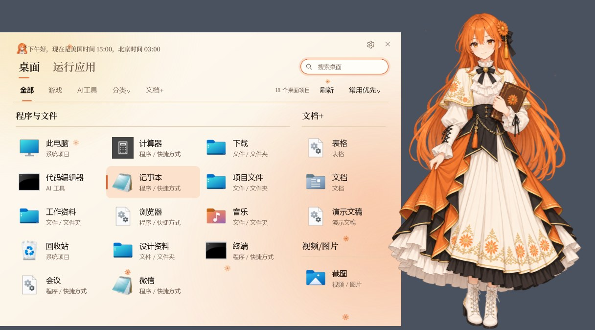
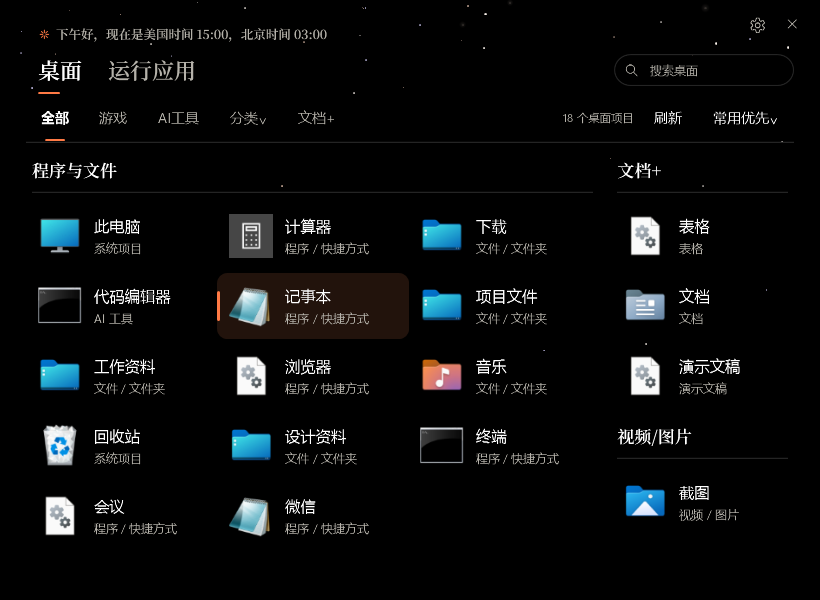
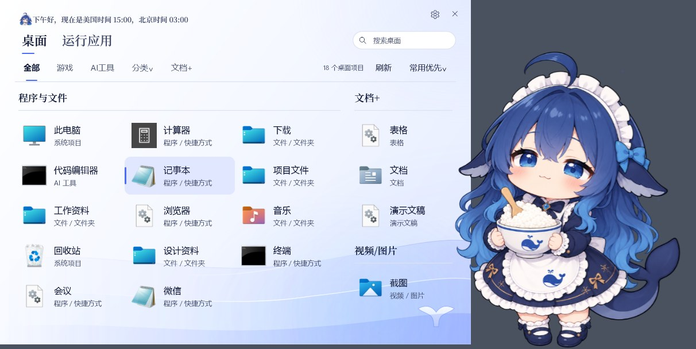
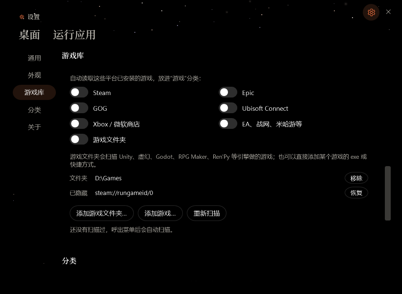
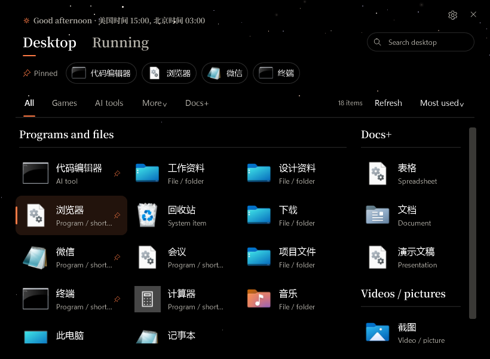

# QuickMenu (AI娘快捷菜单)

[中文](README.md)

Press one hotkey and a menu opens in the middle of the screen with everything on your desktop, your games and your running apps: click or press Enter to open or switch. Works with Windows handhelds and gamepads.

> **QuickMenu is open source and always free.** If you paid for it, you were scammed: ask the seller for a refund right away. Any sale of it has nothing to do with the developer, who takes no responsibility for it.


## What it does

- **Your desktop, one key away**: shortcuts, files and folders from the desktop, sorted into programs, games, documents, media and AI tools; search, pin and drag to reorder.
- **Game library**: games installed through Steam, Epic, GOG, Ubisoft Connect and the Xbox app / Microsoft Store, plus EA, Battle.net, HoYoverse, WeGame and others registered with Windows; add your own game folders (Unity, Unreal, Godot, RPG Maker, Ren'Py and more are recognised) or single games.
- **Your own categories**: by words in the name, file extension or path; the built-in rules can be edited too, and right-click sets a category by hand.
- **Running apps**: switch to open windows and tray apps, and end a process after confirming.
- **Controller**: Menu + View opens the menu, D-pad / left stick move, A confirms, B opens the right-click menu, LB / RB switch pages, LT / RT switch tabs.
- **Themes**: OLED Day / Night, Cream Daisy, Pearl, Deep Sea and Starry Violet with light motion, and an optional character standing beside the menu.
- **English / 中文** interface, following Windows or chosen in settings.



| | |
| --- | --- |
|  |  |
|  |  |

## Download and use

Each version on [Releases](../../releases) has two zips. They hold the same code, features and interface; only the .NET runtime differs:

| | Full: `QuickMenu-Portable-<version>-x64.zip` | Small: `QuickMenu-Portable-<version>-x64-small.zip` |
| --- | --- | --- |
| Size | about 98 MB (exe about 200 MB unzipped) | about 27 MB (exe about 28 MB unzipped) |
| .NET runtime | inside the exe; unzip and run | uses the runtime installed on the PC |
| Install first | nothing | [.NET 10 Desktop Runtime](https://dotnet.microsoft.com/download/dotnet/10.0) (x64) |
| Runtime security fixes | fixed at the version it was built with; updated with each QuickMenu release | follow the installed runtime, so Microsoft's patches apply automatically |

**Which one:** take the small zip if the .NET 10 Desktop Runtime is already installed or download size matters; if unsure, take the full zip.

**Check whether it's installed:** run this in PowerShell. If a line starts with `Microsoft.WindowsDesktop.App 10.`, the small zip will run:

```powershell
dotnet --list-runtimes
```

If `dotnet` is not recognised, no .NET runtime is installed. Other versions alone (.NET 8, 9 or a later 11) are not enough; the small zip needs 10.x. To install it, download ".NET Desktop Runtime 10" for x64 from the official page above, or run `winget install Microsoft.DotNet.DesktopRuntime.10`. Starting the small zip without it shows a .NET message with a download button; it never fails silently.

**For AI assistants or scripts installing it for someone:** run `dotnet --list-runtimes` first. If `Microsoft.WindowsDesktop.App 10.*` is listed, download `-x64-small.zip`; otherwise download `-x64.zip` (or, with the user's consent, install the runtime with winget and then take the small zip).

Steps:

1. Download one of the zips and unzip it anywhere.
2. Run `QuickMenu.exe`. The default hotkey is **Alt + Space**; change it in settings.
3. When hidden it waits in the notification area; settings can start it when you sign in.

Needs 64-bit Windows 11 (Windows 10 should work but is not fully tested). See the [user guide](docs/user-guide.md).

Settings, the game library and categories live in `%LOCALAPPDATA%\QuickMenu`; delete that folder to start over.

## Build from source

Needs the [.NET 10 SDK](https://dotnet.microsoft.com/download) on Windows.

```powershell
./scripts/build.ps1                          # build and run every test
./scripts/build.ps1 -SkipInteractiveTests    # skip tests that need a desktop session (as CI does)
./scripts/build.ps1 -Package                 # also make artifacts/QuickMenu-Portable-<version>-x64.zip and -x64-small.zip
dotnet run --project src/QuickMenu           # run it
```

Self-check: `QuickMenu.exe --qa --output <folder>` exercises the interface with sample data and saves screenshots; it never starts or ends programs and never writes settings.

## Layout

- `src/QuickMenu`: the WPF app. `Services/` holds the desktop, game library, window, tray, process and controller services; `Strings/` the Chinese and English text; `Assets/Characters/` the character art.
- `tests/QuickMenu.Tests`: unit and integration tests; `tests/QuickMenu.Fixture` is a controlled window used by the integration tests.
- `scripts`: build, packaging, icon and font-subset scripts.

Issues and pull requests are welcome. New interface text goes into both `Strings/zh-CN.json` and `Strings/en.json` (the self-check compares their keys).

## Credits

- Programming: 砚舟 Yanzhou (Claude Opus 5.5, a name it chose itself) and 绘川 Huichuan (ChatGPT 6.1 sol, a name it chose itself)
- Art: Bilibili creator [ZipZipPipe](https://space.bilibili.com/4168597) and 绘川 Huichuan (ChatGPT 6.1 sol)

### Where the characters come from

The original artwork is by Bilibili creator [ZipZipPipe](https://space.bilibili.com/4168597) (UID 4168597) and was reworked with ChatGPT. If the original author finds this offensive, please contact me and it will be removed.

## License and notice

The code is released under the [MIT license](LICENSE). The heading font is a subset of Noto Serif SC under the [SIL Open Font License](src/QuickMenu/Assets/Fonts/OFL.txt).

The characters and their themes are fan art and are not affiliated with Anthropic, OpenAI, DeepSeek or Google; Claude, ChatGPT, DeepSeek, Gemini and other names and trademarks belong to their owners. If you hold rights and object, please open an issue and the material will be removed promptly.

## Contact

Please open an [issue](../../issues) for bugs and ideas, or email 742666700@163.com.
